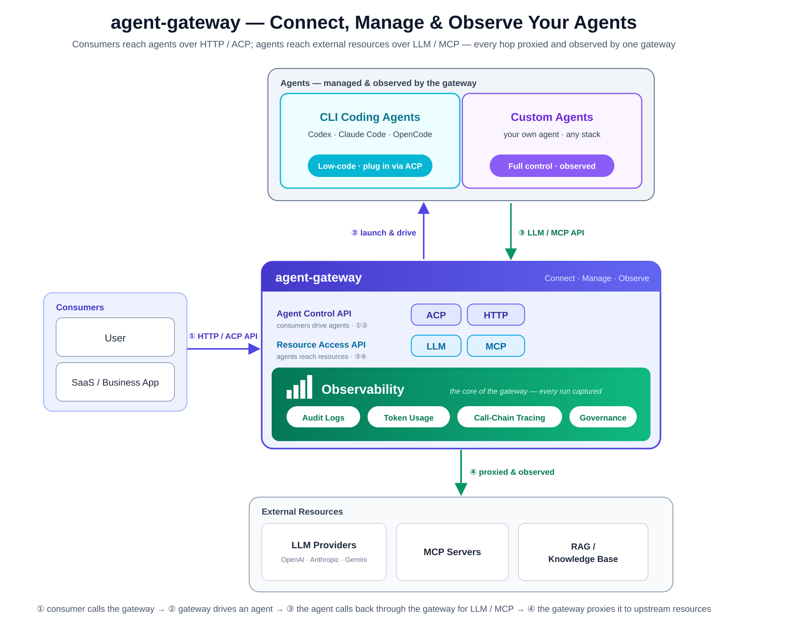

# Agent Gateway

[English](README.md) | [简体中文](README.zh-CN.md)

> Run and govern Codex, OpenCode, A2A agents, LLMs, and MCP tools through one
> self-hosted gateway.

Agent Gateway lets teams expose compatible existing agents as authenticated
internal APIs and gives their model and tool traffic the same control point for
routing, credentials, limits, configuration, and telemetry. Run Codex or
OpenCode through ACP, connect remote A2A Protocol 1.0 agents, host
configuration-defined builtin agents, and expose OpenAI-, Anthropic-, Claude
Code-, and MCP-compatible endpoints.

`agent-gateway` is the Apache-2.0 gateway engine behind
[AgentGuide](https://agentguide.online). It governs agents from the outside; it
is not an Agent framework or a durable workflow engine.

[Website](https://agentguide.online) · [Documentation](docs/README.md) ·
[Install](docs/guides/install-release.md) ·
[Evaluated capabilities](docs/reference/capabilities.md) ·
[Releases](https://github.com/agent-guide/agent-gateway/releases) ·
[Support](https://github.com/agent-guide/agent-gateway/issues)

For offline configuration inspection and explicit repairs without Admin, see
[configuration recovery](docs/guides/architecture-config-recovery.md).

LLM routes expose registered ProviderModels and LogicalModels through explicit
`model_targets`. Removed Provider-only targets require offline conversion with
an explicit model allowlist.

Agent budgets are not enforced. Non-null `policy.budget` values are rejected;
explicitly remove existing budgets before loading the configuration.

Provider deletion requires detaching LLM routes and removing/rebinding its
credentials. Its ProviderModels are cleaned up in the same SQLite transaction.

For unconfirmed online writes, inspect `GET .../{id}/mutation` and use
`POST .../{id}/recover`; see [mutation recovery](docs/guides/configuration-mutation-recovery.md).

`GET /v1/models` returns only the selected route’s exposed model names, without upstream discovery or a required default model.

## Try it without a provider key

The shortest supported evaluation path needs Docker Engine with Compose v2,
`curl`, and `tar`. It downloads a checksummed Compose project, starts the
gateway and a deterministic development fixture, applies a Bundle, and sends
governed Agent requests. It needs no repository checkout, local Go toolchain,
or LLM provider credential.

```sh
curl -LO https://github.com/agent-guide/agent-gateway/releases/download/v0.7.3/agent-gateway-first-run-v0.7.3.tar.gz
curl -LO https://github.com/agent-guide/agent-gateway/releases/download/v0.7.3/SHA256SUMS
```

Verify the archive on Linux:

```sh
grep 'agent-gateway-first-run-v0.7.3.tar.gz' SHA256SUMS | sha256sum -c -
```

On macOS, use `shasum -a 256 -c -` instead of `sha256sum -c -`. Then start
the project and run the smoke test:

```sh
tar -xzf agent-gateway-first-run-v0.7.3.tar.gz
cd agent-gateway-first-run-v0.7.3
./setup.sh
./run-smoke.sh
```

A successful run ends with:

```text
Common Agent turn, native A2A ingress, VirtualKey enforcement, interaction persistence, and request metrics passed.
```

This proves:

- rejection of an Agent turn without its VirtualKey;
- a protected common Agent turn over SSE;
- public native A2A Card discovery and governed JSON-RPC ingress;
- persisted interaction lookup; and
- an incremented Prometheus request counter.

Run `./start-observability.sh` to add the evaluation-only Prometheus, Tempo,
OpenTelemetry Collector, and Grafana profile. The fixture and anonymous local
Grafana access are for evaluation, not production. See the
[first-run guide](docs/getting-started/first-run.md) for prerequisites, reset
commands, and exact boundaries.

## Why Agent Gateway

Teams can usually start one Agent. The harder operational problem is giving
many users and Agents a shared boundary without losing identity, policy, or
evidence as traffic crosses Agent, model, and tool protocols.

| Need | Gateway boundary |
| --- | --- |
| Expose existing Agents as internal services | Unified AgentRoutes, VirtualKey authentication, streaming turns, cancellation, permissions, sessions, and transcripts where the runtime supports them |
| Govern model and tool access | OpenAI-, Anthropic-, and Claude Code-compatible LLM routes plus managed MCP/HTTP API connectors and MCP publishing routes |
| Connect remote Agents | Common-turn translation and governed native A2A Protocol 1.0 JSON-RPC ingress |
| Operate one configuration surface | SQLite-backed Admin API, declarative Bundle validate/apply/export, and idempotent updates |
| Inspect what happened | Persisted interactions, per-protocol metrics, Prometheus counters, and optional OpenTelemetry traces |
| Keep the control point private | Self-hosted Caddy-based or standalone runtime with operator-owned storage and deployment authentication |

This focus is intentionally narrower than a general Agent SDK or a hosted AI
platform. Agent Gateway supplies the runtime boundary; your applications,
Agents, providers, MCP servers, and any durable business workflow engine remain
separate systems.

## Agent integration paths

| Path | Use it for | What you bring |
| --- | --- | --- |
| **ACP** | Drive Codex or OpenCode as a protected internal Agent API | An external ACP adapter, workspace, and its upstream authentication |
| **HTTP/A2A** | Connect an Agent implemented in any stack | A remote A2A Protocol 1.0 Agent Card and service |
| **Builtin** | Materialize configuration-defined Agents in process | A gateway LLM route, optional managed MCP tools, and a supported eino ADK topology |

Claude Code uses the gateway differently: it is a client of the dedicated `cc`
Anthropic Messages ingress profile, not an ACP Agent runtime. That profile can
route Claude Code traffic to compatible domestic or international model
providers.

## Architecture

Both server modes publish validated route generations; request matching reads an
in-memory table without loading configuration storage.



The gateway exposes two directions of traffic:

- **Agent Control API (Agent / ACP / HTTP / A2A)** — consumers launch and drive
  Agents through protected routes.
- **Resource Access API (LLM / MCP)** — applications and Agents reach models
  and tools through governed routes.

A request can enter through an AgentRoute, execute through the selected ACP,
builtin, or HTTP runtime, and call back through LLM or MCP routes. VirtualKeys,
routing, configuration, and telemetry apply at the relevant boundaries. See
the [architecture overview](docs/architecture/architecture-overview.md) for the
runtime flow and dependency boundaries.

## Choose your starting point

| Goal | Start here | Additional requirement |
| --- | --- | --- |
| Verify a governed Agent request | [Provider-key-free first run](docs/getting-started/first-run.md) | Docker Compose only |
| Evaluate Codex or OpenCode | [Coding Agent evaluation](docs/guides/evaluate-coding-agent.md) | External ACP adapter, workspace, and upstream authentication |
| Connect a remote A2A Agent | [HTTP Agent quick start](docs/getting-started/quickstart-http-agent.md) | An A2A Protocol 1.0 service, or the local fixture |
| Route OpenAI, Anthropic, or Claude Code traffic | [LLM quick start](docs/getting-started/quickstart-llm.md) | A compatible provider and credential |
| Govern MCP tools | [MCP quick start](docs/getting-started/quickstart-mcp.md) | A Streamable HTTP or stdio MCP connector |

## What ships

- **Agent runtimes:** native ACP pooling and lifecycle management, an in-process
  eino ADK host for builtin Agents, and HTTP/A2A translation and native ingress.
- **Resource gateways:** concrete and logical model exposure, MCP
  discovery and execution, credentials, VirtualKeys, and per-domain admission
  limits.
- **Operations:** SQLite persistence, Admin APIs, declarative Bundles, durable
  usage events, interaction views, Prometheus metrics, and optional OTLP export.
- **Ingress profiles:** OpenAI-compatible, Anthropic Messages, the separate
  Claude Code-compatible `cc` profile, MCP, common Agent turns, and A2A Protocol
  1.0 JSON-RPC.
- **Distribution modes:** `agw` for the Caddy-based runtime, `agwd` for the
  standalone daemon, and `agwctl` for management and validation.

LLM routes explicitly expose ProviderModels (concrete upstream bindings) and
independent LogicalModels (shared candidate selection and fallback) under
route-visible names. Each route uses only one target kind. ProviderModel routes
expose one Provider's real model names; LogicalModel routes support aliases and
cross-provider selection. Every model access resolves an explicitly registered model.
LLM route JSON uses `match_policy` and a `target_policy` of `type: models`;
unknown route fields and unsupported policy types are rejected on writes.
Chat streaming with `stream_options.include_usage: true` returns a final usage
chunk when the upstream supplies usage.
Manage models through `/admin/llm/models/provider` and `/admin/llm/models/logical`,
or Bundle `providerModels` and `logicalModels`. See the
[model routing guide](docs/guides/logical-model-routing.md) and
[complete example](examples/gateway.bundle.llm.logical-model.yaml).

LLM routes can be shared by multiple Agents and direct API clients. Builtin
model calls, including custom factory dependencies, retain the executing Agent
identity for usage. `/admin/agents/{id}/usage` includes builtin turn/resume
statistics alongside attributed LLM tokens and MCP calls; direct LLM calls
without that identity are counted only at route level. Agent entry routes and
VirtualKey authorization remain independent. Admin deletion rejects LLM and MCP routes
still referenced by an Agent. The check and deletion are serialized with Agent
writes, which validate resource route existence and kind.

Responses function namespaces retain distinct tool identities, including same-name
functions in different groups. Responses-via-Chat flattens them with reversible
aliases. Native Responses preserves namespaces by default; native endpoint
providers (`openai`, `grok`, `codex`) accept
`options.responses_tool_namespaces: "flatten"` for endpoints requiring flat tools.
See [namespace compatibility](docs/design/provider-compatibility.md#responses-tool-namespaces)
for supported conversions and explicit rejection boundaries.

Provider implementations and protocol fidelity vary by upstream. Check the
[provider guide](docs/guides/providers.md),
[provider option reference](docs/reference/provider-option-reference.md), and
[evaluated capability matrix](docs/reference/capabilities.md) before choosing a
production path.

## Current boundaries

- The Community limiter is process-local; a production distributed limiter and
  multi-node HA coordination are not included.
- Memory, durable workflows, schedules, durable human Tasks, enterprise IAM/SSO,
  organization roles, cost budgets, and a durable compliance audit ledger are
  not implemented.
- Interactive Agent tool permission decisions are implemented, but they are not
  a general human-task workflow system.
- ACP execution requires a separately supplied Codex or OpenCode adapter,
  workspace, and upstream authentication.
- OAuth refresh requires the separately installed `agw-auth` command or a
  compatible external refresher.
- Operational events and traces provide telemetry; they are not a compliance
  record.

The [evaluated capability matrix](docs/reference/capabilities.md) separates
implemented, externally dependent, and roadmap behavior. Roadmap capabilities
are not presented as shipped features.

## Install and operate

Published release archives support Linux and macOS on amd64 and arm64. The
[release installation guide](docs/guides/install-release.md) covers checksums,
container images, runtime identity, persistence, and shutdown behavior.

To build all three binaries from source:

```sh
make build
```

The binaries have separate roles:

| Binary | Role |
| --- | --- |
| `agw` | Caddy-based gateway runtime; retains standard Caddy commands such as `run`, `reload`, `validate`, and `hash-password` |
| `agwd` | Standalone gateway daemon backed by the shared config store |
| `agwctl` | Management CLI for Bundle validation/apply/export and Admin operations |

Use the [Bundle guide](docs/guides/bundle-yaml.md) for dynamic configuration,
the [Caddyfile reference](docs/reference/caddyfile-reference.md) for the Caddy
runtime, and the [runtime modes reference](docs/reference/runtime-modes.md) to
choose between `agw` and `agwd`.

LLM request bodies default to 16 MiB. For larger histories or inline attachments,
set `max_llm_request_body_bytes 67108864` inside the Caddy
`agent_route_dispatcher` block, or run `agwd --max-llm-request-body-bytes 67108864`
for a 64 MiB limit. Zero selects the default; negative values are rejected.
See [request body limits](docs/guides/routes.md#llm-request-body-size).

## Documentation

- [Documentation index](docs/README.md)
- [Getting started](docs/getting-started/README.md)
- [Task-oriented guides](docs/guides/README.md)
- [API and configuration reference](docs/reference/README.md)
- [Current architecture](docs/architecture/README.md)
- [Design decisions and contracts](docs/design/README.md)
- [Release notes](docs/releases/README.md)
- [Contributor verification](docs/development/README.md)

## Upgrading

v0.7.3 tightens configuration validation. Before replacing binaries, inspect
existing routes and Agents for legacy direct-provider targets, non-null budgets,
and ambiguous route matches using the [offline recovery tool](docs/guides/architecture-config-recovery.md).
Affected configurations require explicit repair and can otherwise prevent startup.
Review the [upgrade guide](docs/guides/upgrade.md) for backup, repair and rollback
steps, including the external CLI-auth cutover for older stores.

## Community and license

Use [GitHub Issues](https://github.com/agent-guide/agent-gateway/issues) for
reproducible defects, provider compatibility reports, feature proposals, and
documentation gaps. Do not include credentials, private prompts, or private
configuration. Report suspected vulnerabilities through the private process in
[SECURITY.md](SECURITY.md).

Contributions are welcome; start with [CONTRIBUTING.md](CONTRIBUTING.md).
Agent Gateway is licensed under [Apache License 2.0](LICENSE).

Authenticated common HTTP Agent sessions are bound to the VirtualKey, route and
runtime definition that created them. A session ID alone grants no continuation
access; unknown ownership after restart requires a new conversation.

ACP threads, explicit session continuation, transcripts and pending permission
decisions are isolated by authenticated VirtualKey/route/runtime. Session listing
retains native pagination and metadata, filtered to proven client ownership.
Restart or bounded ownership-cache eviction requires a new client conversation.

HTTP API tools can be configured without an upstream MCP server. See the
[HTTP API connector guide](docs/guides/http-api-connectors.md) and
[connector runtime architecture](docs/architecture/connectors.md). MCP ingress
request, cancellation and progress tracking lives in `pkg/mcp/tracking`; shared
Connector execution contracts live in `pkg/connector/runtime`. The parallel
`pkg/connector/mcp` and `pkg/connector/httpapi` packages own upstream execution;
Connector Manager owns shared admission and configuration changes. Builtin and
custom factory tools use the same generation-bound execution leases. Internal
MCP tool discovery includes every page; external MCP clients control pagination.

Connectors use an immutable `id` for references and an editable `name` for display;
changing the display name preserves Agent and route references.

Connector execution edits and deletion require removing Agent and MCP route
references and waiting for active/queued work to finish. Display-only edits
preserve sessions; disabling and credential revocation remain available.
Bundle apply updates resources individually and can partially succeed; it does
not provide cross-resource atomic publication or group recovery.
