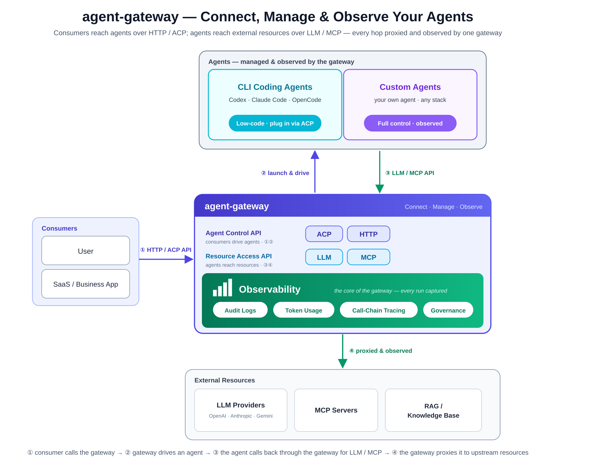

# Agent Gateway

[English](README.md) | [简体中文](README.zh-CN.md)

> 通过一个自托管网关，统一运行和治理 Codex、OpenCode、A2A Agent、LLM 和
> MCP 工具。

Agent Gateway 让团队可以把兼容的现有 Agent 暴露为带鉴权的内部 API，并让它们
访问模型和工具的流量经过同一个控制点，统一处理路由、凭证、限流、配置和遥测。
你可以通过 ACP 运行 Codex 或 OpenCode，连接远程 A2A Protocol 1.0 Agent，在
进程内托管由配置定义的 builtin Agent，并提供兼容 OpenAI、Anthropic、Claude
Code 和 MCP 的入口。

`agent-gateway` 是 [AgentGuide](https://agentguide.online) 背后采用 Apache-2.0
许可证的网关引擎。它从 Agent 外部实施治理；它不是 Agent 框架，也不是持久化
工作流引擎。

[官网](https://agentguide.online) · [文档](docs/README.md) ·
[安装](docs/guides/install-release.md) ·
[已验证能力](docs/reference/capabilities.md) ·
[版本发布](https://github.com/agent-guide/agent-gateway/releases) ·
[支持](https://github.com/agent-guide/agent-gateway/issues)

## 无需模型 Provider Key 即可试用

最短的受支持验证路径只需要安装带 Compose v2 的 Docker Engine、`curl` 和
`tar`。它会下载经过校验的 Compose 项目，启动网关和确定性开发 Fixture，应用
Bundle，并发送受治理的 Agent 请求。整个过程不需要克隆仓库、本地 Go 工具链或
LLM Provider 凭证。

```sh
curl -LO https://github.com/agent-guide/agent-gateway/releases/download/v0.7.2/agent-gateway-first-run-v0.7.2.tar.gz
curl -LO https://github.com/agent-guide/agent-gateway/releases/download/v0.7.2/SHA256SUMS
```

在 Linux 上校验压缩包：

```sh
grep 'agent-gateway-first-run-v0.7.2.tar.gz' SHA256SUMS | sha256sum -c -
```

在 macOS 上把 `sha256sum -c -` 替换为 `shasum -a 256 -c -`。然后启动项目并
运行冒烟测试：

```sh
tar -xzf agent-gateway-first-run-v0.7.2.tar.gz
cd agent-gateway-first-run-v0.7.2
./setup.sh
./run-smoke.sh
```

成功运行后，最后会看到：

```text
Common Agent turn, native A2A ingress, VirtualKey enforcement, interaction persistence, and request metrics passed.
```

这会验证：

- 没有 VirtualKey 的 Agent Turn 会被拒绝；
- 受保护的通用 Agent Turn 可以通过 SSE 完成；
- 公开的原生 A2A Agent Card 发现和受治理的 JSON-RPC 入口可以工作；
- 可以查询持久化的 Interaction；
- Prometheus 请求计数器发生递增。

运行 `./start-observability.sh` 可以增加仅用于验证的 Prometheus、Tempo、
OpenTelemetry Collector 和 Grafana。Fixture 和允许本地匿名访问的 Grafana
均不属于生产部署方案。前置条件、重置命令和准确能力边界见
[首次运行指南](docs/getting-started/first-run.md)。

## 为什么选择 Agent Gateway

团队通常能够启动一个 Agent。更难的运维问题是如何为更多用户和 Agent 建立
共享边界，同时在流量经过 Agent、模型和工具协议时保留身份、策略与运行证据。

| 需求 | 网关提供的边界 |
| --- | --- |
| 把现有 Agent 暴露为内部服务 | 统一的 AgentRoute、VirtualKey 鉴权、流式 Turn、取消、权限，以及 Runtime 支持时的 Session 和 Transcript |
| 治理模型和工具访问 | 兼容 OpenAI、Anthropic 和 Claude Code 的 LLM 路由，以及统一管理的 MCP Service 和 Route |
| 连接远程 Agent | 通用 Turn 转换和受治理的原生 A2A Protocol 1.0 JSON-RPC 入口 |
| 使用一个配置入口运维 | SQLite 支撑的 Admin API、声明式 Bundle validate/apply/export 和幂等更新 |
| 查看实际发生了什么 | 持久化 Interaction、分协议指标、Prometheus 计数器和可选 OpenTelemetry Trace |
| 将控制点保留在私有环境 | 自托管的 Caddy 或独立守护进程 Runtime，存储和部署鉴权均由运维方控制 |

这个定位有意比通用 Agent SDK 或托管 AI 平台更窄。Agent Gateway 提供 Runtime
边界；你的应用、Agent、Provider、MCP Server，以及任何持久化业务工作流引擎，
仍然是独立系统。

## Agent 接入路径

| 路径 | 适用场景 | 需要自行提供 |
| --- | --- | --- |
| **ACP** | 把 Codex 或 OpenCode 作为受保护的内部 Agent API 驱动 | 外部 ACP Adapter、Workspace 及其上游鉴权 |
| **HTTP/A2A** | 连接由任意技术栈实现的 Agent | 远程 A2A Protocol 1.0 Agent Card 和服务 |
| **Builtin** | 在进程内实例化由配置定义的 Agent | Gateway LLM Route、可选的统一管理 MCP 工具，以及受支持的 eino ADK Topology |

Claude Code 的使用方式不同：它是专用 `cc` Anthropic Messages 入口 Profile 的
客户端，而不是 ACP Agent Runtime。该 Profile 可以把 Claude Code 流量路由到
兼容的国内或国际模型 Provider。

## 架构



网关处理两个方向的流量：

- **Agent Control API（Agent / ACP / HTTP / A2A）**——调用方通过受保护的路由
  启动和驱动 Agent。
- **Resource Access API（LLM / MCP）**——应用和 Agent 通过受治理的路由访问
  模型和工具。

请求可以从 AgentRoute 进入，通过选定的 ACP、builtin 或 HTTP Runtime 执行，
并通过 LLM 或 MCP Route 回调网关。VirtualKey、路由、配置和遥测会作用于相应
边界。完整 Runtime 流程和依赖边界见
[架构概览](docs/architecture/architecture-overview.md)。

## 选择起点

| 目标 | 从这里开始 | 额外要求 |
| --- | --- | --- |
| 验证一次受治理的 Agent 请求 | [无需 Provider Key 的首次运行](docs/getting-started/first-run.md) | 只需要 Docker Compose |
| 验证 Codex 或 OpenCode | [Coding Agent 验证指南](docs/guides/evaluate-coding-agent.md) | 外部 ACP Adapter、Workspace 和上游鉴权 |
| 连接远程 A2A Agent | [HTTP Agent 快速开始](docs/getting-started/quickstart-http-agent.md) | A2A Protocol 1.0 服务或本地 Fixture |
| 路由 OpenAI、Anthropic 或 Claude Code 流量 | [LLM 快速开始](docs/getting-started/quickstart-llm.md) | 兼容的 Provider 和凭证 |
| 治理 MCP 工具 | [MCP 快速开始](docs/getting-started/quickstart-mcp.md) | Streamable HTTP 或 stdio MCP Service |

## 已包含的能力

- **Agent Runtime：**原生 ACP Pool 和生命周期管理、托管 builtin Agent 的进程内
  eino ADK Host，以及 HTTP/A2A 转换和原生入口。
- **资源网关：**直连 Provider 或 Logical Model 的 LLM 路由、MCP 发现和执行、
  Credential、VirtualKey，以及按领域区分的准入限流。
- **运维：**SQLite 持久化、Admin API、声明式 Bundle、持久化 Usage Event、
  Interaction 视图、Prometheus 指标和可选 OTLP 导出。
- **入口 Profile：**OpenAI 兼容、Anthropic Messages、独立的 Claude Code 兼容
  `cc` Profile、MCP、通用 Agent Turn 和 A2A Protocol 1.0 JSON-RPC。
- **分发模式：**用于 Caddy Runtime 的 `agw`、独立守护进程 `agwd`，以及负责
  管理和校验的 `agwctl`。

不同上游的 Provider 实现和协议保真能力并不相同。选择生产路径前，请查阅
[Provider 指南](docs/guides/providers.md)、
[Provider 选项参考](docs/reference/provider-option-reference.md)和
[已验证能力矩阵](docs/reference/capabilities.md)。

## 当前边界

- Community 限流器在单进程内工作；不包含生产级分布式限流器和多节点 HA 协调。
- Memory、持久化 Workflow、Schedule、持久化 Human Task、企业 IAM/SSO、组织
  Role、成本预算和持久化合规审计账本尚未实现。
- 交互式 Agent 工具权限决策已经实现，但它不是通用 Human Task 工作流系统。
- ACP 执行需要另行提供 Codex 或 OpenCode Adapter、Workspace 和上游鉴权。
- OAuth 刷新需要单独安装 `agw-auth` 命令或兼容的外部刷新程序。
- 运维 Event 和 Trace 提供遥测证据，但不构成合规记录。

[已验证能力矩阵](docs/reference/capabilities.md)区分了已实现、依赖外部组件和路线图
能力。路线图能力不会被描述为已经交付。

## 安装和运行

已发布的 Release 压缩包支持 Linux 和 macOS 的 amd64 与 arm64。
[Release 安装指南](docs/guides/install-release.md)说明了校验和、容器镜像、Runtime
身份、持久化和停止行为。

从源码构建全部三个二进制：

```sh
make build
```

三个二进制职责不同：

| 二进制 | 职责 |
| --- | --- |
| `agw` | 基于 Caddy 的 Gateway Runtime；保留 `run`、`reload`、`validate` 和 `hash-password` 等标准 Caddy 命令 |
| `agwd` | 使用共享 ConfigStore 的独立 Gateway Daemon |
| `agwctl` | 用于 Bundle validate/apply/export 和 Admin 操作的管理 CLI |

动态配置见 [Bundle 指南](docs/guides/bundle-yaml.md)，Caddy Runtime 配置见
[Caddyfile 参考](docs/reference/caddyfile-reference.md)，如何在 `agw` 和 `agwd`
之间选择见 [Runtime 模式参考](docs/reference/runtime-modes.md)。

## 文档

- [文档索引](docs/README.md)
- [快速开始](docs/getting-started/README.md)
- [任务指南](docs/guides/README.md)
- [API 和配置参考](docs/reference/README.md)
- [当前架构](docs/architecture/README.md)
- [设计决策和契约](docs/design/README.md)
- [版本发布说明](docs/releases/README.md)
- [贡献者验证流程](docs/development/README.md)

## 升级

v0.7.2 没有在 v0.7.0 之外增加协议或持久化资源迁移。尚未完成自 v0.5.0 起记录
的外部 CLI 鉴权切换的 Store，需要执行一次性 Credential 迁移并单独安装刷新
命令。在阅读适用的[升级指南](docs/guides/upgrade.md)并准备回滚方案前，请勿开始
升级。

## 社区与许可证

请通过 [GitHub Issues](https://github.com/agent-guide/agent-gateway/issues)提交可复现
缺陷、Provider 兼容性报告、功能建议和文档问题。不要提交 Credential、私有
Prompt 或私有配置。疑似安全漏洞请使用 [SECURITY.md](SECURITY.md)说明的私密
报告流程。

欢迎参与贡献，请先阅读 [CONTRIBUTING.md](CONTRIBUTING.md)。Agent Gateway 使用
[Apache License 2.0](LICENSE)。
