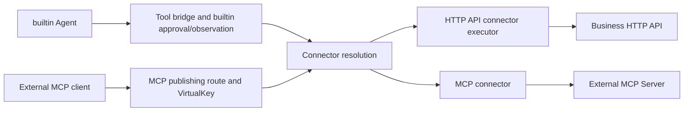

# Connectors: HTTP APIs, MCP, and Tool Publishing

Capability status: **Implemented**. The connector model, HTTP executor,
builtin/MCP adapters, management surfaces, explicit offline conversion,
observation and simplified lifecycle contract are implemented. See
[current runtime architecture](../architecture/connectors.md).

Connector is the domain object for integrating external capabilities. Its two
types are HTTP API connector and MCP connector. Builtin Agents can invoke a
connector's tools in process, and MCP publishing routes can expose those same
capabilities to external clients. This document defines the full target
contracts. Configuration examples for individual connectors are supported. Each resource is updated independently.

## 1. Background and Goals

Users have HTTP APIs for operations such as looking up orders, searching a
knowledge base, or creating tickets. They want Agents to call these APIs without
writing and deploying a separate MCP Server.

The pre-connector implementation provided:

- `mcp_services` configuration, Admin CRUD, and Bundle management.
- stdio, SSE, and Streamable HTTP transports for existing MCP services.
- An in-process bridge through `pkg/mcp/einotool` for builtin tool calls.
- MCP routes, VirtualKey admission, builtin tool approval, and MCP observability.

That baseline did not have an executor mapping ordinary HTTP APIs into tools. Existing
skills return inline instructions; they neither execute scripts nor automatically
turn API descriptions into callable tools.

After configuring API operations, parameters, and authentication, users should be
able to:

1. Select tools by name in builtin Agents.
2. Describe how to use those tools in skills.
3. Publish the same tools to external clients through MCP routes.
4. Inspect tool execution and downstream HTTP requests in the gateway.

## 2. Core Decisions

### 2.1 Independent Connectors, Connector-Owned Tools, and Agent References

External capabilities belong to independent Connector objects. The existing MCP
service model becomes the MCP connector, and HTTP API connectors add API mapping.
The configuration collection is `connectors`. There is no new global `tools`
object, and MCP service does not remain a parallel domain concept.

| Object | Ownership and responsibility |
| --- | --- |
| Connector | Independent of an Agent; owns connection configuration, authentication, execution boundaries, and a capability catalog |
| HTTP API connector | Maps HTTP API operations into tools through declarative configuration |
| MCP connector | Connects to an external MCP Server, discovers and invokes tools, and retains existing resources, prompts, and other capabilities |
| Tool definition | Belongs to a connector; has a name, description, and input Schema; HTTP API tools additionally define request and response mappings |
| Agent | Declares connector dependencies, selects tools, and configures builtin approval |
| MCP publishing route | Exposes connector capabilities to external clients, with ingress matching and VirtualKey policy |
| Skill | Provides tool-use instructions; owns neither tool implementations nor credentials |

MCP is a protocol. An MCP Server provides external capabilities, and an MCP
connector integrates that server into the gateway. MCP and tools are not peer
domain resources. Tools are the callable capability common to both connector
types. HTTP API tools come from configuration; MCP tools come from upstream
discovery and do not require HTTP mapping fields. Resources and prompts remain
distinct capabilities; this design does not reduce MCP connectors to tools only.

Connector identity uses `id` plus `name`, with no separate `slug` field.
`id` is a required, case-sensitive identifier supplied at creation, unique
within the connector collection and immutable for the lifetime of that object.
References, Admin paths, credential ownership and approval entries use this ID.
`name` is a mutable display name; it need not be unique and never resolves a
reference. Updating a name preserves the ID and all existing references.
For `PUT /admin/connectors/{id}`, an omitted body ID inherits the path ID; a
supplied nonempty ID must match it after normal whitespace normalization.
A different ID is rejected before mutation rather than silently overwritten.
Changing the ID requires creating a separate object and explicitly moving its
references. A display-name change requires no coordinated Agent/route update.
Tool names retain their separate protocol identity and selection contracts.

Tool identity is `(connector_id, tool_name)`. Names may repeat across connectors
but must be unique within one connector. Tools have no independent CRUD,
versioning, or publishing lifecycle. HTTP API connector updates atomically replace
their tool set; MCP catalog refresh follows the upstream discovery contract.

Independent definitions allow reuse but do not grant execution authority or
promise per-user credential selection. Existing exclusive MCP route declarations
and service-session constraints remain; see [MCP route sharing](mcp-route-sharing.md).

### 2.2 Connector Type Is Separate from MCP Transport

The root `type` selects the integration:

- `type = mcp`: an MCP connector using an external MCP Server, with transport,
  address, or process configuration.
- `type = http_api`: an HTTP API connector whose configured tools execute HTTP
  requests directly.

HTTP API execution does not introduce another MCP transport, a synthetic upstream
MCP connection, or an HTTP loopback call into the gateway.

The target configuration is a strict union. Root `type` is required. Type `mcp`
requires a non-null `mcp` object; type `http_api` requires a non-null `http_api`
object. The other branch must be absent, even if its value would be empty or
null. Unknown types, unknown fields, and old flat connection fields are rejected.
There are no compatibility aliases.

Minimal target MCP connector:

```json
{
  "id": "existing-mcp",
  "name": "Existing MCP connector",
  "disabled": false,
  "type": "mcp",
  "mcp": {
    "transport": "streamable_http",
    "url": "https://mcp.example.com/mcp"
  }
}
```

Existing fields move as follows, retaining their values and transport semantics:

| Existing fields | Target location |
| --- | --- |
| `id`, `name`, `description`, `disabled`, `created_at`, `updated_at` | Connector root |
| `audit` | Connector root, subject to capture rules for the connector type |
| `transport`, `command`, `args`, `url`, `post_url`, `env`, `auto_auth`, `auth` | Same field names inside `mcp` |

MCP `auth` retains the current `type`, `api_key`, `username`, and `password`
structure. This proposal does not convert it into a credential reference. HTTP
API connectors use the credential manager. This deliberate asymmetry avoids
changing existing MCP authentication and session behavior while introducing HTTP
API connectors. Current MCP inline authentication injects configured static
secrets into request headers; it has no credential refresh path. `auto_auth` is a
stored field with no active read/refresh implementation. Preserve its value in
conversion without activating it or introducing OAuth refresh. Unifying MCP
authentication requires a separate design; existing MCP configuration receives
only the field relocation above.

The absence of inline secrets in HTTP API connector configuration does not imply
that the entire `connectors` collection or credential store never persists
secrets. Migration and audit tooling must continue to treat existing MCP inline
authentication and environment configuration as sensitive.

Implementation must provide explicit offline conversion and recovery. Conversion
atomically relocates fields and preserves metadata without implicitly copying or
creating credentials. Admin, Bundle, CLI, and documentation must change together.
Ordinary startup and Refresh do not convert old formats.

### 2.3 Shared Execution Through Two Entry Points



The connector layer provides a common tool discovery and invocation interface.
Builtin Agents use that interface for either connector type. MCP connectors turn
calls into upstream `tools/call`; HTTP API connectors map them into HTTP requests.
Agents do not implement two tool invocation flows.

The HTTP executor must not depend on `pkg/agent`. It consumes neutral request
context, credential access interfaces, and execution configuration. Builtin and
external entry points retain ownership of authorization, observation, and request
lifecycle.

### 2.4 Domain Naming Migration from MCP Service

The following names are targets, not claims about current code or API support.
The rename covers the domain model, configuration, and management surfaces;
changing UI labels alone would leave HTTP APIs under the wrong domain object.

| Pre-cutover implementation | Target name or contract |
| --- | --- |
| MCP service / `MCPServiceConfig` / MCP service manager | Connector / `ConnectorConfig` / connector manager, owning both types' configuration and lifecycle |
| ConfigStore collection and SQLite physical table `mcp_services` | Collection and table `connectors`; preserve IDs and explicitly convert existing records to `type=mcp` |
| Bundle `mcpServices` | `connectors`; `mcpRoutes` continues to describe MCP publishing routes |
| Agent `resources.mcp_service_ids` | `resources.connector_ids` |
| Agent resources inspection response `resolved.mcp_services` | `resolved.connectors`; distinct from the Agent definition's stored ID list |
| Builtin tool selection `mcp_service_id` | `connector_id` |
| Builtin permission event/continuation payload `mcp_service_id` | `connector_id`; rename the internal pending-call and decision DTO fields together, retaining call/request IDs and approval strings |
| MCP route and target-policy `service_id` | `connector_id`; retain `kind=mcp`, `protocol=mcp`, and existing route IDs |
| Persisted `target_policy.kind = mcp-service` | `target_policy.kind = connector`; retain the MCP route kind/protocol and its existing ID |
| `/admin/mcp/services/...` | `/admin/connectors/...`; move discovery, invocation, and connector state inspection, including the `tools`, `capabilities`, `sessions`, `resources`, `resource-templates`, and `prompts` subroutes |
| Root command `agwctl mcp-service` | Root command `agwctl connector`; retain sibling `mcp-route` and `mcp-runtime` commands |
| New HTTP API credential ownership | `connector:<connector_id>`, initially used only by HTTP API connectors |

The Admin subtree move preserves the existing relative operations, including
`tools/call`, `resources/read`, and `prompts/get`. MCP connectors retain those
capabilities. HTTP API connectors expose only their implemented tool and state
capabilities; sharing a management namespace does not grant resources, prompts,
or upstream MCP sessions. Unsupported operations fail explicitly.

The current CLI registers resource commands directly under `agwctl`; the removed
`gateway` parent must not be restored. This rename does not relocate protocol
commands beneath `connector`.

There are no existing MCP service Caddyfile blocks or Caddy app JSON fields to
rename. The Caddy app's static resource inputs are providers and LLM routes;
standalone `--static-config` likewise instantiates providers, model resources and model exposure
LLM routes. Initially connectors are persisted configuration managed through Admin
and online Bundle apply. Connector definitions in Caddy static configuration or
standalone static Bundles are unsupported and must be explicitly rejected rather
than accepted and ignored. Adding static connectors requires a separate design.
The host-owned HTTP policy and OTLP settings below remain supported host settings,
not static connector definitions.

Configuration validation, Admin clients, Bundle export/apply, CLI, main assembly,
and dependency injection must adopt the same names. The public tool bridge should
also use connector terminology instead of placing HTTP execution under an MCP
upstream service manager. Package moves must preserve the dependency rule that
lower protocol packages do not depend on Agent definitions.

The protocol ingress remains an MCP route, presented in the UI as MCP publishing.
`/admin/mcp/routes/...`, the existing `/admin/mcp/runtime/...` dispatcher diagnostics
(runtime summary, inflight requests, progress, and history), and MCP transport
names retain their protocol identity. Connector-specific discovery and state
inspection move with `/admin/mcp/services/...`; dispatcher diagnostics do not.
Both connector types can be MCP publishing targets. Publishing an HTTP API
connector neither creates a second MCP connector nor changes its type to `mcp`.

Migration changes object shapes and reference fields while preserving connector
IDs, tool names, route IDs, and approval-entry strings. It adds neither old-name
aliases nor automatic dual reads. Offline conversion checks target collection
conflicts and atomically migrates the physical configuration table, record
envelopes, Agent references, and both target-policy discriminator and reference
fields. Failure cannot leave mixed collections or partially converted routes.
The offline repair tool must understand raw old records without normal startup
decoding. New loading rejects the old discriminator and field names, including
empty/null aliases. The historical usage table/column exceptions in section 7.2
do not apply to configuration tables.

Before registering stores or running any schema creation/migration, both hosts
and store-opening CLI paths must perform a read-only legacy-layout preflight.
The presence of the old `mcp_services` table, even if empty or alongside
`connectors`, requires explicit offline conversion or repair and aborts startup
without modifying the database. Never create an empty `connectors` table and
then rely on record decoding to detect the old layout: those old rows would not
be read. Fresh databases and fully converted databases pass this check. Offline
conversion removes the legacy table only as part of its successful atomic
commit; target-table conflicts are diagnosed without altering either table.

Agent resources inspection is a derived response and is renamed in its serializer,
not migrated as a stored Agent field. Builtin permission checkpoints are in memory;
there is no persistent permission migration or checkpoint format to introduce.
The cutover drains or cancels old runs and suspended permissions before retiring
the old process; old payload field names are not accepted by the new runtime.
Protected Enterprise SPI and public event transport retain their extension
compatibility rules throughout the rename; the permission DTO change does not
implicitly rename protected public event fields.

Architecture pages, guides, README, examples, and root/nested AGENTS describe
the connector model. Old names in this document identify the pre-connector
baseline, explicit migration mappings, or historical physical storage.

## 3. Configuration Contract

This is a connector object accepted by the Connector Admin API, not a complete Bundle:

```json
{
  "id": "order-api",
  "name": "Order system connector",
  "disabled": false,
  "type": "http_api",
  "http_api": {
    "base_url": "https://orders.example.com",
    "auth": {
      "type": "bearer",
      "credential_ref": "orders-token"
    },
    "timeout_ms": 10000,
    "max_response_bytes": 1048576,
    "tools": [
      {
        "name": "get_order",
        "description": "Look up order status by order ID",
        "input_schema": {
          "type": "object",
          "properties": {
            "order_id": { "type": "string", "minLength": 1 }
          },
          "required": ["order_id"],
          "additionalProperties": false
        },
        "request": {
          "method": "GET",
          "path": "/orders/{order_id}",
          "path_params": {
            "order_id": { "argument": "order_id" }
          }
        },
        "response": {
          "select": "/data"
        }
      }
    ]
  }
}
```

### 3.1 Input and Request Mapping

- Initially support GET and POST with JSON requests and responses.
- Input Schema must have an object root. The initial JSON Schema subset supports
  basic types, object properties, required, additionalProperties, enum, array
  items, lengths, and numeric bounds, exactly as specified in section 3.4.
  Reject unsupported keywords and all `$ref`; never silently ignore constraints.
- `path_params` accepts only `{"argument": "parameter_name"}` referencing a
  top-level input parameter. Static segments belong directly in the path.
  `query` and `body` entries accept either an argument binding or a static JSON
  binding `{"value": ...}`, exclusively. Initial body mapping supports flat
  fields; it does not introduce expressions or script/string templates.
- Static configuration values, including base URLs, literal paths, Schemas,
  descriptions, query/body bindings, and headers, must contain only non-secret
  data: they are persisted and may be exported in Bundles. Do not place API keys,
  tokens, passwords, or other authentication material in them. Authentication
  belongs only in credential-manager references with the supported header
  injection; APIs requiring query/body credentials are outside initial scope.
  Validation rejects inline secret fields in `http_api.auth` and reserved
  headers, but cannot reliably recognize an arbitrary secret disguised as business data;
  configuration authors remain responsible for keeping static values secret-free.
- Every path placeholder requires a binding. Encode each value as one path
  segment and reject dot segments, slashes, or values that alter path structure.
  Encode query parameters with standard URL encoding and bodies with JSON encoding.
- Initially reject null/array/object query values. Static query null is a
  configuration error, and query argument bindings must reference Schemas that
  exclude null, arrays, and objects. Omitted optional arguments produce no query
  entry; an empty string produces `key=`. String values are encoded as supplied;
  boolean and number values use their JSON scalar spelling followed by standard
  URL encoding, without coercing the validated input type. Recheck these rules
  at invocation before network work.
- Initially reject dynamic headers, arbitrary URL arguments, and caller-supplied
  request configuration. Non-sensitive static headers may be configured;
  reserved protocol and authentication headers cannot be overridden.
- GET has no body; POST uses JSON. Omit absent optional parameters. In JSON body
  mappings, static null emits JSON null and remains distinct from an absent
  field. Do not implicitly coerce types or inject Schema defaults.
- Validate parameters, mappings, and encoded results before network work. Model
  input cannot override operation names, destinations, or credentials.

### 3.2 Responses and Errors

- A 2xx response satisfying the JSON contract succeeds. Normalize 204 to `{}`
  before applying the same selection rules as other successful responses. Empty
  bodies with other statuses remain invalid JSON.
- Except for normalized 204, require `Content-Type: application/json` or an
  `application/*+json` media type, with no charset or `charset=utf-8`. Parse one
  complete UTF-8 JSON value, rejecting duplicate members, invalid Unicode,
  trailing values and nesting beyond 64 container levels. Reject non-identity
  Content-Encoding rather than transparently decompressing it. These failures
  are `response_invalid`; retain the actual byte-read bound independently.
- `response.select` is an optional JSON Pointer. Omission selects the full body;
  an explicit empty string selects the root. A missing pointer or invalid body
  produces a bounded mapping error. Thus 204 succeeds with `{}` when select is
  absent or `""`, but fails mapping with `/data`; selection is never bypassed.
- Successful results provide MCP `structuredContent` and serialized JSON text
  content for the existing Agent bridge. Wrap selected scalars or arrays as
  `{"result": ...}` in structured output.
- HTTP non-2xx responses, timeout, network failure, and oversized responses
  produce tool results with `isError=true`, stable error categories, and sanitized
  descriptions. Never forward arbitrary upstream error bodies into model output
  or logs.
- The MCP boundary maps JSON-RPC envelope errors, unknown tools, and invalid
  arguments into protocol errors; the builtin bridge receives corresponding call
  errors. Downstream HTTP 4xx/5xx do not directly set the ingress HTTP status.
- Do not infer business success from arbitrary JSON content. Business errors
  inside 2xx responses follow the API contract or later explicit response rules.
- Initially perform no automatic retries. HTTP calls must not enter the existing
  MCP reconnect/retry path. Cancellation or timeout does not prove that the server
  failed to commit a write; report a potentially unconfirmed outcome rather than
  encouraging the model to retry writes automatically.

### 3.3 Exact HTTP API Configuration Shape

All configuration objects below reject unknown fields, duplicate JSON member
names, and explicit null unless a field explicitly permits it. Optional fields
take defaults only when absent. YAML decoding must preserve these checks rather
than discarding duplicate keys. Connector root metadata retains existing MCP
field semantics; `type` is immutable after creation. Changing integration type
requires explicit deletion and recreation under normal reference guards.

| Object | Fields and validation |
| --- | --- |
| `http_api` | Required `base_url` and `tools`; optional `auth`, `timeout_ms`, `max_response_bytes`. No other fields |
| `http_api.auth` | Omission or `{"type":"none"}` means no authentication. `{"type":"bearer","credential_ref":"id"}` injects `Authorization: Bearer <secret>`. `{"type":"api_key","credential_ref":"id","header_name":"X-API-Key"}` injects the secret as the complete header value. Each variant rejects fields belonging to another variant; `none` accepts only `type` |
| Tool | Required `name`, `description`, `input_schema`, `request`; optional `response`. Names match `^[A-Za-z0-9_.-]{1,64}$` and are unique per connector; description is nonempty UTF-8, at most 4096 bytes |
| `request` | Required `method` (`GET` or `POST`, uppercase) and `path`; optional `path_params`, `query`, `body`, `headers`. These maps default to empty; `body` must be absent for GET, even if empty |
| `path_params` | Placeholder name to argument-binding object; every placeholder has exactly one binding and unused bindings are rejected. A placeholder occupies a complete segment and matches `^[A-Za-z_][A-Za-z0-9_]*$`. Its argument must be a required, nonempty string property |
| `query` | Nonempty parameter name to argument or static-value binding, one value per name. Scalar encoding and null rejection follow section 3.1 |
| `body` | Output field name to argument or static-value binding. Output keys are literal top-level JSON names, not paths; an absent map emits `{}` for POST. Nested values may come from an object/array argument or static JSON value, without recursive template expansion |
| Binding | Exactly `{"argument":"top_level_property"}` or `{"value":<JSON value>}`. Argument names must appear in root `properties`. `value:null` is allowed only in a body binding; missing optional arguments omit their output field |
| `headers` | Static header-name to single string value; names must be HTTP tokens and unique case-insensitively. Values reject CR, LF, NUL and other control characters |
| `response` | Only optional `select`, a string containing a valid JSON Pointer. Omission defaults to the full body; validate pointer escaping at publication |

Header reservation is case-insensitive. Reject `Authorization`,
`Proxy-Authorization`, `Host`, `Cookie`, `Set-Cookie`, `Content-Type`,
`Content-Length`, `Content-Encoding`, `Transfer-Encoding`, `Connection`,
`Keep-Alive`, `TE`, `Trailer`, `Upgrade`, `Accept`, and `Accept-Encoding`, plus
names beginning `Proxy-`, `Sec-`, `Forwarded`, or `X-Forwarded-`. The API Key
`header_name` cannot be reserved or also appear in `request.headers`. The name
must itself be a valid HTTP token, at most 128 bytes. A credential reference is
a nonempty concrete ID under the existing credential ID rules, not a scope
selector, URL or environment expression. The
executor owns `Accept: application/json`, `Accept-Encoding: identity`, and POST
`Content-Type: application/json`; it never forwards ingress headers. Secret
values containing control characters fail credential eligibility for this
injection before HTTP work. Authentication material cannot be embedded in a
header prefix/suffix template. Reserved authentication header checks are not a
general secret detector for arbitrary business fields.

The root `audit.capture_tool_args` setting preserves current behavior for MCP
connectors. Initially HTTP API connectors accept omission or false only; true
is rejected so existing explicit capture cannot accidentally expose API data.
The compact public tool-list bound in section 5 and Admin's 4 MiB full-body
bound also apply; do not use a larger Bundle body limit to bypass them.

### 3.4 Input Schema and JSON Validation

The HTTP API subset is defined by the following allowlist, not by whatever a
chosen validation library happens to accept. It does not restrict Schemas
discovered from MCP connectors, which retain their upstream contract.

| Keyword | Supported form and semantics |
| --- | --- |
| `type` | Required at every Schema node. One of `object`, `array`, `string`, `number`, `integer`, `boolean`, `null`, or a nonempty list of distinct such strings. Root must be exactly `"object"`. Bounds apply only to matching instance types |
| `title`, `description` | String annotations; no validation side effects |
| `properties`, `required` | For object-capable nodes only. `properties` maps names to Schema nodes; `required` is a unique list of declared property names. Defaults are empty. No undeclared required names |
| `additionalProperties` | Boolean only, for object-capable nodes. Omission means true; false rejects undeclared properties. Schema-valued forms are unsupported |
| `items` | One Schema node, required for array-capable nodes. Tuple forms and implicit unconstrained item Schemas are unsupported |
| `enum` | Nonempty array of distinct JSON values, each satisfying the other constraints at that node. Equality is structural, ignores object key order, and compares numbers mathematically |
| `minLength`, `maxLength` | Nonnegative integers for string-capable nodes; count Unicode code points |
| `minItems`, `maxItems` | Nonnegative integers for array-capable nodes |
| `minimum`, `maximum`, `exclusiveMinimum`, `exclusiveMaximum` | Finite JSON numbers for number/integer-capable nodes; exclusive bounds take numbers, not booleans. Reject contradictory bounds and min/max pairs |

Reject every other keyword, including `$schema`, `$id`, `$ref`, `$defs`,
`definitions`, composition/conditionals, `format`, `pattern`, `default`, and
`nullable`. Explicit `type` unions express nullable inputs where permitted;
query/path bindings must still satisfy their narrower type constraints.
Never resolve references, fetch remote documents, coerce inputs, insert defaults,
or remove undeclared properties to make an invocation valid.

An omitted protocol arguments member is normalized to `{}` at ingress; an
explicit null is not omission. Parse supplied arguments as one complete UTF-8
JSON object. Reject null roots, trailing
JSON values, duplicate member names, invalid Unicode and non-finite numbers.
Preserve JSON numbers without float64 rounding; an integer has no fractional
mathematical value, regardless of decimal/exponent notation. Validation and
mapping use the same parsed values. Numeric query spelling is a valid JSON
number representation of that preserved value, with no rounding.

Bound each tool Schema to 64 KiB of compact UTF-8 JSON and 32 nested Schema
nodes on any path; publication also rejects unsupported or unsatisfiable
constraints. Invocation arguments are at most 1 MiB before parsing and 64 JSON
container levels deep. Apply the same limits in builtin, Admin invocation and
MCP publishing, even when another transport permits a larger envelope. Mapped
JSON request bodies retain the independent 1 MiB limit from section 6.2.

## 4. Builtin Agents and Skills

Agents use unified connector dependencies and tool selection. Example builtin
configuration fragment:

```json
{
  "tools": [
    {
      "connector_id": "order-api",
      "tools": ["get_order"]
    }
  ]
}
```

`order-api` must also appear in the Agent's `resources.connector_ids`. Dependencies
are management declarations. Explicit tool selection controls what reaches the
model; a missing named tool fails rather than falling back to all tools. Omitted
tool-name lists retain the existing bridge's behavior.

Connector-local names are not automatically namespaced in model tool lists.
Within one builtin model node, selected tool names must be unique across its
connectors and middleware tools; materialization rejects a collision and names
both sources. Different nodes may reuse a name. Initial scope introduces no
implicit renaming or model-visible aliases; permission identity remains the
original `(connector_id, tool_name)` pair.

The model uses its normal tool-calling mechanism. A skill can instruct it to ask
for an order ID before invoking the lookup tool. Loading that skill does not
execute an API call or expand the Agent's tool set or permissions.

HTTP API tools use builtin interactive approval. Auto-approval entries have the
form `connector_id/tool_name`; preserving IDs and names preserves their existing
string values. Denied or suspended calls perform no HTTP request. Read-only skill
loading without external effects remains exempt from approval.

Builtin API calls require neither a public MCP route nor an external MCP Server.
Python/Bash executors, skill packages, and session workspaces are outside this
proposal. An API may target an external execution service, but that does not add
an embedded script runtime to the gateway.

## 5. Publishing Capabilities Through MCP Routes

An MCP publishing route references the HTTP API connector's `connector_id` and
configures VirtualKey admission. It does not copy the connector or credentials;
builtin continues to invoke the original connector directly. Clients authenticate
to the gateway with the ingress VirtualKey, while the gateway uses connector
credentials against the business API. These authentication boundaries are separate.
The gateway terminates MCP and maps API operations:

| MCP capability | HTTP API connector behavior |
| --- | --- |
| Initialization and capability negotiation | Gateway-owned; advertise only implemented capabilities, without an upstream MCP connection |
| `tools/list` | Generate names, descriptions, and inputSchema from published configuration |
| `tools/call` | Resolve a tool, validate arguments, apply mappings, call the API, and convert results |
| Ping and initialization notifications | Handle in the gateway protocol layer under the existing contract |
| Cancellation notifications | Cancel the matching HTTP request after existing request-ownership checks |
| Resources, prompts, completions | Do not advertise support; return an explicit unsupported protocol error on invocation |

Initially require 1-128 tools per HTTP API connector. The `tools/list` result,
encoded as compact UTF-8 JSON using the actual public fields, must not exceed
1 MiB. This includes tool names, descriptions, Schemas, and list wrapping, but
excludes the JSON-RPC envelope. Check both fixed limits before publication;
reject excess rather than truncating or paginating. Builtin discovery uses the
same catalog and limits. List-changed notifications and asynchronous tasks are
not promised. The gateway still manages external MCP sessions, but HTTP API
connectors own no upstream MCP session.

The configured tool collection is the published set. Route-level filtering and
aliasing remain the separate Proposed [MCP Tool Policy](mcp-tool-policy.md) design;
this proposal does not assume they are implemented. Define distinct connectors
when distinct publishing sets are required.

External clients do not pass through builtin approval. MCP route and VirtualKey
policy govern admission. Per-call human approval for external ingress would need
its own suspension and continuation contract.

## 6. Credentials and Network Boundaries

### 6.1 Credential References

Initially support no authentication, Bearer, and static API Key header injection.
HTTP API connector authentication stores only `credential_ref` and injection
settings, not plaintext secrets. All other static configuration follows the
non-secret authoring contract in section 3.1; this is not a promise of automatic
secret detection in arbitrary business data. Basic, OAuth user authorization,
and per-caller credential selection are outside the initial scope. This does
not change the MCP inline authentication model in section 2.2 or promise that
the credential store never persists secrets.

Reuse the credential manager with a newly recognized non-Provider scope:
`connector:<connector_id>`. The original credential model did not accept this scope. The implementation must
recognize it; do not bypass validation with a fictitious LLM Provider or an HTTP
Agent's scope.

An eligible credential has the referenced ID, type `api_key`, enabled status, a
nonempty secret, an exact connector-owned scope, and empty Provider fields.
Normalize the scope prefix while preserving the connector ID suffix's case under
connector identity rules. Configuration validity and execution readiness are
separate:

| Stage | Validation and failure semantics |
| --- | --- |
| Writes | Admin Create/Update and online Bundle apply validate connector structure and credential-reference shape, then compute readiness from the current credential manager. Ineligible dependencies produce a stored but unready connector, not a rejected configuration write |
| Loading and Refresh | Validate connector structure and reference shape; missing, disabled, wrong-type/scope, or empty-secret credentials make only the affected connector unready, without rejecting the catalog. Scope ownership can be checked only when the credential exists |
| Execution | Fetch by referenced ID from current credential-manager memory and recheck full eligibility on every call; fail closed before HTTP work if any condition fails |

Bundles have no credential-manager object collection. HTTP API connectors carry
only credential references, not the referenced secrets; provision those
credentials separately through credential management. Do not treat the connector
submission set as a credential catalog. This does not make an entire Bundle
secret-free: MCP connectors retain their inline `mcp.auth` and `mcp.env` values
through export/apply and offline conversion. Treat Bundles containing those
values as sensitive; do not strip them or replace them with new credential
references implicitly. Online apply and Admin writes use the same structural
admission rules; neither requires HTTP API credentials to exist before connector
publication. Readiness may remain false until the reference becomes eligible.

Bundle validate and offline CLI inspection check connector structure, reference
shape, and references resolvable from the supplied configuration. They cannot
verify live credential eligibility. Report that limitation explicitly without
failing structural validation merely because a credential is absent from the
Bundle. A valid Bundle does not imply execution readiness, and neither writes nor
readiness caches replace execution-time checks. Static connector admission is
unsupported as specified in section 2.4.

Readiness inspection and each execution read credential eligibility directly
from the credential manager's current in-memory state. Maintain no second
credential-readiness cache, lifecycle-listener registry or reverse dependency
index for HTTP connectors. Rotation is observed on the next call without
rewriting connector configuration, rebuilding its catalog or reconnecting MCP.
Existing credential revocation remains independent of connector edit admission.

- `credential_ref` selects a concrete ID. Scope constrains ownership, not
  selection. Multiple credentials may share a scope; only the explicit reference
  is used, with no uniqueness requirement within that scope.
- Do not invoke Provider credential selection, priority, quota/unavailable
  scheduling, or automatic failover. HTTP API 401/429 responses do not update
  Provider scheduling state. An unavailable reference never falls back to another
  credential in the scope.
- Configuration snapshots, tool lists, and prepared HTTP clients never retain
  resolved secrets.
- Deletion and disabling are valid revocation operations. Subsequent calls fail
  closed, while connector deletion does not cascade credential deletion. After
  revocation, restart still loads the connector and marks it unready. Already
  transmitted requests cannot be recalled; observability must not claim
  retroactive revocation.
- Authentication is connector-scoped. Do not forward caller Authorization or
  select secrets from model input. Use separate connector configurations for
  different tenant credentials.

### 6.2 Network and Resource Limits

- `base_url` is fixed and rejects userinfo, query, fragment, and model-controlled
  hosts. HTTPS is the production default; HTTP requires an explicit host-policy
  exception.
- `request.path` is a template relative to the base path. It must begin with one
  `/` and contain no query/fragment. That slash is a joining separator, not a URL
  reference that replaces the base path. Strip trailing `/` from the base path
  and append the template: `https://host/api/v1/` plus `/orders/{id}` becomes
  `https://host/api/v1/orders/{id}`. An empty base path starts at the root. Reject
  suspicious input rather than cleaning it: dot segments, backslashes, encoded
  separators, and values enabling traversal through repeated decoding are invalid.
- Reject absolute URLs, protocol-relative URLs, and any configuration that can
  override the base origin/path. Verify the final origin and base-path segment
  boundary before sending.
- Host egress policy restricts domains, ports, and address ranges. Configuration
  objects cannot relax it. Loopback, link-local, private, and other nonpublic
  targets are denied by default; internal APIs need explicit administrator grants.
- Check addresses after DNS resolution and at actual dialing to prevent rebinding.
  Disable implicit environment proxies. Initially disable automatic redirects to
  prevent credential forwarding across destinations.
- `timeout_ms` defaults to 10000 and accepts 1-60000. The effective deadline is the
  earlier of the caller deadline and connector timeout.
- `max_response_bytes` defaults to 1 MiB and accepts 1 byte-8 MiB. Enforce actual
  bytes read rather than trusting Content-Length. Initial JSON request bodies
  have a fixed 1 MiB limit; compressed responses are unsupported.
- Admission uses coordinated counters; do not hold a global execution slot while
  waiting for a connector slot. Defaults are 128 active and 256 queued globally,
  and 16 active and 32 queued per connector. Full queues return bounded capacity
  errors immediately. Queue time counts toward the deadline, and cancellation
  removes queued work promptly. Cancellation, turn timeout, and gateway shutdown
  propagate to HTTP requests; no background continuation is provided.
- Initially use no CookieJar, forward no Set-Cookie, cache no responses, and share
  no mutable caller-header state.

Both hosts load the same local JSON policy file. Host settings are
`http_api_policy_file <path>` inside the global Caddy `agent_gateway` block, a
matching Caddy JSON field, and standalone `--http-api-policy-file <path>`. They
inject the same immutable policy structure. The file defines egress rules, HTTP
exceptions, and global/per-connector execution and queue limits. Limits must be
positive, with per-connector limits no greater than global limits. Without a file,
use the defaults above and public HTTPS targets only. Policy is not stored in
`connectors` or relaxed through Agent/Bundle/Admin configuration. Invalid policy
fails host startup or reload rather than reverting to permissive behavior.
Changes take effect through host configuration reload or restart; file watching
is not promised.

### 6.3 Host Policy File Schema and Evaluation

The file is a UTF-8 JSON object, at most 1 MiB, with duplicate/unknown fields
and explicit null rejected. It is read locally during host preparation, never
through a URL. `version` is required and initially equals 1. Omitted fields use
the following complete defaults:

```json
{
  "version": 1,
  "default_action": "public_https",
  "rules": [],
  "limits": {
    "global_active": 128,
    "global_queued": 256,
    "connector_active": 16,
    "connector_queued": 32
  }
}
```

`default_action` is `public_https` or `deny`. `public_https` admits public HTTPS
on port 443 only; other ports, HTTP and nonpublic addresses require an explicit
allow rule. `deny` requires an explicit allow for every destination. `limits`
accepts only the four fields above, each an integer from 1 through 65536;
per-connector active/queued limits cannot exceed their respective global limit.
An omitted file is equivalent to the object above. The limits are uniform
across connector IDs; per-ID overrides are outside initial scope.

Each rule contains exactly `action`, `schemes`, `hosts`, `ports`, and `cidrs`.
`action` is `allow` or `deny`; all four selector arrays are required, nonempty
and duplicate-free. A rule matches when every dimension matches:

- `schemes`: `http` and/or `https`.
- `hosts`: lowercase ASCII DNS names or canonical IP literals without brackets.
  A single leading `*.` matches one or more subdomain labels, never the apex;
  other wildcards, Unicode names, URL syntax and trailing dots are rejected.
  Requests normalize DNS name case and IP spelling before matching. IPv6 zones
  are unsupported and IPv4-mapped IPv6 is evaluated as IPv4.
- `ports`: integers 1-65535, matched against the effective port (443 or 80 when
  absent in the URL).
- `cidrs`: canonical IPv4/IPv6 networks; `0.0.0.0/0` and `::/0` explicitly mean
  every address in that family. An exception should use the narrow networks it
  intends to grant, for example `10.20.0.0/16` for an internal service.

Rule order is irrelevant: any matching deny wins, then a matching allow, then
the default action. The default public-address set is globally routable unicast;
exclude private, loopback, link-local, multicast, unspecified, reserved,
documentation, benchmarking, carrier-grade NAT and other special-use ranges.
Maintain an explicit, tested special-use prefix table in the implementation;
checking only a language library's private-address predicate is insufficient.
An administrator can grant otherwise excluded ranges with an explicit allow
rule, subject to deny precedence.

For example, with `default_action=deny`, this rule grants just the named HTTPS
service on the selected private network:

```json
{
  "action": "allow",
  "schemes": ["https"],
  "hosts": ["orders.internal.example"],
  "ports": [443],
  "cidrs": ["10.20.0.0/16"]
}
```

Static connector admission checks scheme/host/port and whether policy can permit
the configured destination, without DNS or business API calls. If a CIDR deny
can only be decided after resolution, defer that part to execution. For each
execution, resolve through the host resolver, bound resolution by the call
deadline, and require every returned address to pass the complete rule set.
No answers, denied answers or resolution failure fail closed. Dial only an
admitted IP from that resolution result, retain the configured host for TLS
verification/SNI, and verify the actual peer before sending HTTP bytes. Never
validate one resolution then let the default dialer resolve again.

Connection reuse is keyed by origin and current host-policy revision; a reused
peer must belong to the call's admitted resolution result and still pass
destination admission before a new request. A policy
reload fences old pools and closes idle connections. New calls, including those
using an old connector lease, use current policy and current pools. Requests
already sent may finish under their admission decision; tightening policy does
not claim retroactive recall. Disabling environment proxies, redirects,
compression and cookie state remains mandatory even for explicitly allowed hosts.

## 7. Unified Observability

Observation distinguishes one logical tool execution from its HTTP request:

```text
builtin turn / MCP ingress request
  +-- Tool invocation span (logical execution)
      +-- HTTP client span (network request)
```

### 7.1 Event Ownership

- Builtin retains its observed-tool wrapper as the owner of MCP tool usage.
  The tool bridge remains an adapter and writes no additional usage.
- Existing MCP ingress observation owns usage for external calls.
- The HTTP executor creates the HTTP child span and returns bounded execution
  metadata; it never writes another logical tool usage event.
- Builtin denials appear in permission/turn events and create no HTTP span.
  Parameter failures and other calls that send no HTTP request cannot fabricate
  network spans either.

Count each actual tool execution once. HTTP summaries and tracing children do not
increment tool-call or failure totals again.

### 7.2 Persistence and Export Contract

Extend the existing `MCPUsageEvent` and `mcp_usage_events`; add no HTTP usage family
or table. The MCP event family remains an existing tool-interaction metering
contract, not a domain object name. Add nullable `connector_type` and a nullable,
typed `http_execution` summary. Store the summary in a constrained JSON column
read and written through typed DTOs. Arbitrary properties and complete HTTP
objects are forbidden. Existing rows retain null; do not infer connector types
for historical events.

New tool observation code uses `connector_id`. Existing typed events and the
SQLite `service_id` column retain their historical physical mapping, without
configuration/API aliases or changes to historical caller attribution. Protected
public DTOs are not renamed implicitly; connector management terminology and
event compatibility are separate contracts. Public event changes must follow the
extension contract.

`http_execution` contains only method, host/port without authentication material,
path template, nullable status code, HTTP execution duration, request-body byte
count, response-body bytes read, and a stable network-error category. It exists
only after HTTP execution starts; connection failure can have no status code.
HTTP duration excludes tool validation and queueing. Byte counts after
cancellation or size rejection describe observed bytes, not a complete response.
Return metadata to the owning observer through a request-private typed channel,
never model-visible tool results or MCP `_meta`. Concurrent calls must not share
metadata.

The persisted/query DTO uses the following exact JSON fields (Go runtime DTO
fields use their PascalCase equivalents). All fields are required except
`network_error_category`; unknown status is encoded as `status_code:null`:

| Field | Type and meaning |
| --- | --- |
| `method` | String, `GET` or `POST` |
| `host_port` | String, normalized configured host and explicit effective port; IPv6 is bracketed; never userinfo |
| `path_template` | String, configured joined base path plus operation template, not expanded argument values |
| `status_code` | Nullable integer, HTTP status when response headers were received |
| `duration_ms` | Nonnegative int64 milliseconds, from first dial or admitted pooled-request start through completion/failure, excluding queueing and preflight validation/DNS policy admission |
| `request_body_bytes` | Nonnegative int64, actual body bytes consumed by the transport, not a claim that the remote server received or committed them |
| `response_body_bytes` | Nonnegative int64, actual bytes read, including the bounded overflow probe on size rejection |
| `network_error_category` | Optional string, only `network_error`, `timeout`, or `cancelled` |

At most one overflow byte beyond `max_response_bytes` is read to detect excess.
`HTTPExecution` is allocated only when dialing or an admitted pooled request
starts; DNS/policy rejection before that has no HTTP summary or child span.
Use a monotonic clock for duration. The internal DTO may use `*int` for status,
but serializers and SQL decoding enforce the field types above and reject
additional properties.

HTTP child spans are tracing only, following the existing direct component-span
export pattern. Reuse the logical tool trace ID, parent to its span, allocate a
new span ID, and use CLIENT kind. The lifecycle exporter owns them. They register
no additional global callback, write no SQLite row or public event, and affect
neither usage/interaction totals nor Prometheus request counts.

Propose OTLP option `http_client_spans`, disabled by default, with the following
matching host and assembly surfaces:

| Surface | Setting |
| --- | --- |
| Public `distribution.OTLPConfig` | `HTTPClientSpans bool` with JSON name `http_client_spans,omitempty` |
| Internal usage OTLP configuration | Matching `HTTPClientSpans` field, explicitly copied by the public-to-internal adapter and consumed during lifecycle exporter assembly |
| Caddy JSON | `agent_gateway.metrics.otlp.http_client_spans` |
| Caddyfile | No-argument `http_client_spans` inside `agent_gateway` -> `metrics` -> `otlp`, analogous to the existing `components` switch |
| Standalone daemon | `--metrics-otlp-http-client-spans`, default false |

`distribution.OTLPConfig` is a designated protected distribution surface. Adding
the field requires the compatibility process in the enterprise extension
contract, corresponding adapter/clone/serialization and host-parity checks, and
`make test-extension-consumer`; ordinary root tests alone are insufficient.
Public configuration must not expose internal usage types. These settings are available in both shipping hosts.

Export only when the option, exporter, and valid parent interaction context all
exist. With OTLP or
this option disabled, Admin still queries HTTP summaries on logical MCP events,
but there is no separate HTTP history event or reconstructible child span. Child
spans cannot be replayed from SQLite. Export failure follows existing tracing
failure isolation and does not affect API execution.

Logical tool spans still export through the usage pipeline, optionally carrying
sanitized HTTP summary attributes. Public `pkg/event` DTOs retain their allowlist;
SQLite additions do not automatically publish target hosts, paths, or new fields.
Any new public field needs explicit assessment and declaration.

### 7.3 Fields and Metrics

New tool events record `connector_type=mcp|http_api`. Tool observation correlates
connector ID, tool name, result category, duration, and trusted execution identity.
HTTP spans record method, target service, status, network-error category, and
request/response byte counts.

Tool error categories distinguish at least input validation, unavailable
credentials, egress denial, network failure, timeout, cancellation, HTTP error,
and response mapping/size failures. Errors before network work have no fabricated
HTTP status.

Agent/run correlation comes only from trusted execution context. External calls
do not acquire an Agent identity through connector or route references. Existing
historical MCP attribution fallback is a separate migration concern and is
neither removed nor expanded here.

Do not record authentication headers, secrets, full arguments, bodies, or raw
queries by default. Record path templates rather than values such as order IDs.
HTTP API argument capture is initially rejected as specified in section 3.3;
existing MCP explicit audit settings keep their documented behavior.

Initially Prometheus usage labels remain only `route_kind` and `runtime_type`.
Add neither `connector_type`/HTTP method/status labels nor an HTTP request metric
family. Connector types, HTTP fields, and connector/tool identities support typed
event queries, OTLP attributes, and bounded breakdowns. Future labels or HTTP
metrics require an explicit change to the [observability invariants](../../internal/observability/AGENTS.md)
and `PrometheusLabels` contract, with cardinality bounds. Being bounded alone does
not authorize a label. Request IDs, run IDs, dynamic URLs, and parameter values
never become metric labels.

Existing Admin metrics, events, and OTLP must expose the new connector type.
Update event validation, persistence, query, export, and required schema
migrations together rather than adding fields only to logs.

## 8. Publication, Dependencies, and Lifecycle

The mutation rules in this section are the implemented simplified contract.
Composed managers share reference coordination; the Connector manager atomically
registers work and excludes execution edits using its in-memory snapshot lock.
No network I/O runs under these coordination or snapshot locks.

- Writes validate structure, Schemas, mappings, credential-reference shape, and
  static egress policy, then compile an immutable tool catalog. Writes and
  loading/Refresh compute dependency readiness under section 6.1 without making
  credential eligibility a configuration admission requirement. No per-request
  config-store reads or reparsing raw configuration are allowed.
- Each call binds to one connector configuration generation. Schema and request/
  response mapping come from that generation. Builtin materializations must use
  the same tool version as execution. Connection/execution changes are rejected
  while referenced or busy; a dormant handle from a replaced execution generation
  fails closed on its next invocation. Display-only edits preserve execution
  state. Never apply an old Schema to a new mapping.
- Credential revocation and tightened host egress policy still apply at execution
  time; old generations cannot bypass them.
- Validate updates and Refresh before publication. Invalid configuration preserves
  the last valid generation. Ineligible credentials publish unready state rather
  than authorizing through an old generation. Unconfirmed persistence follows
  the shared control-plane recovery contract; do not silently degrade or replay
  writes.
- Agent `resources.connector_ids` and MCP publishing route `connector_id` are
  strong dependencies, including disabled objects. Agent/route writes require
  an existing connector. Connector deletion is rejected while any such reference
  remains. Checks and writes share application coordination and the established
  lock order; a check followed by an unguarded write is insufficient.
- Connector updates distinguish display metadata from execution configuration.
  `name` and `description` may change even while referenced or busy, and must not
  close/reconnect an MCP session or replace its execution/catalog generation.
  `id` and `type` remain immutable. Server-owned timestamps retain normal CRUD
  semantics and do not count as execution changes.
- All `mcp`, `http_api` and `audit` configuration is execution-affecting,
  including addresses, process settings, inline authentication, credential
  references, timeouts, tool definitions, Schemas and mappings. Reject changes
  to any of it while an Agent/MCPRoute reference remains, or while the connector
  has active work. Do not limit this guard to deleting selected tool names.
- Active work covers admitted tool/resource/prompt calls, queued executions,
  remote discovery and connection initialization from every entry point,
  including Admin and retained builtin handles. An idle cached MCP session or
  an uninvoked immutable handle alone is not active work. Releasing a route or
  Agent reference does not cancel or erase its already-admitted work.
- Reject deletion while referenced or busy. For writes, treat semantically
  unchanged execution settings as unchanged, even in a full-object PUT or
  Bundle upsert. Compare without server timestamps; a display-only update must
  remain possible without disconnecting clients.
- Reference checks, busy checks, publication, and invocation/initialization
  admission must be serialized so a new call or reference cannot enter between
  a successful check and mutation. Register active work before network work,
  release it on every success/error/cancellation path, and hold no control-plane
  or snapshot write lock across network I/O. Reject conflicts immediately; do
  not wait for drain, force-close active sessions or maintain old/new execution
  generations to permit an edit. Apply this rule to manager/direct callers,
  Admin, Bundle and Refresh paths; unchanged definitions do not count as edits.
- Administrative disablement and live credential revocation retain their
  existing fail-closed admission semantics even while referenced or busy. They
  are explicit revocation controls, not replacement execution definitions.
  They do not imply remote rollback or confirmation that sent writes were
  cancelled. Re-enabling still uses current policy, credentials and configuration.
- Resources are updated independently. There is no cross-resource transaction,
  coordinated publication group, composite execution view or group recovery.
  Each successful update leaves its own persisted configuration and runtime
  view coherent. Single-resource unconfirmed outcomes remain gated and are
  recovered by inspecting stored facts without replaying writes.
- To change execution configuration on the same ID, first remove all Agent
  declarations/tool selections and remove or retarget all MCPRoutes. Wait for
  admitted work to finish, edit the now-unreferenced idle connector, then restore
  references. For a staged replacement, create a separate connector with a new
  ID and desired definition, move references individually, and delete the old
  connector once unreferenced and idle. There are no cascading reference edits.
- Bundle apply remains ordered, per-resource work with partial success. A
  single Bundle cannot bypass reference/busy checks against current state.
  Earlier successful steps remain committed when another object fails.
- Ordinary immutable descriptors and catalogs are GC-managed memory. Tool handles
  own no per-handle connection pool or process and need no reference-counted
  resource-retirement subsystem. HTTP calls own their transports; the Connector
  manager owns MCP sessions and closes idle sessions when replacing an admitted
  unreferenced definition. Shutdown separately stops admission, cancels work and
  confirms exit within a bounded budget, with inspectable close errors.
- Do not relax MCP route sharing, rewrite historical attribution, or claim that
  existing connector-scoped MCP sessions isolate callers.

### 8.1 Neutral Runtime Interface and Generation Leases

Introduce `pkg/connector` for connector models/management and
`pkg/connector/runtime` for neutral execution contracts. The latter imports
neither `pkg/agent` nor HTTP/Admin or observability persistence packages.
Connector MCP adapters use `pkg/mcp` protocol primitives and the existing MCP
transport/session runtime; the HTTP API executor implements the same tool
contract. Agent composition and ingress observers remain above both adapters.
These are new interfaces, not replacements of protected Enterprise SPI without
the compatibility process.

The required interface shape is:

```go
type Resolver interface {
    Acquire(ctx context.Context, connectorID string) (Lease, error)
}

type Lease interface {
    Descriptor() Descriptor
    ListTools(ctx context.Context) (ToolCatalog, error)
    CallTool(ctx context.Context, request ToolCall) (CallOutcome, error)
    Close() error
}

type Descriptor struct {
    ConnectorID string
    Type        string // mcp or http_api
    Generation  string
    Incarnation string
}

type ToolCatalog struct {
    Generation string // opaque catalog identity, bound to config generation
    Tools      []mcp.Tool
}

type ToolCall struct {
    Name      string
    Arguments map[string]any // numbers use json.Number
    Progress  func(Progress)
}

type CallOutcome struct {
    Result  *mcp.ToolResult
    HTTP    *HTTPExecution
    Failure *ExecutionFailure
}

type ExecutionFailure struct {
    Category         string
    Message          string
    OutcomeUncertain bool
}
```

`mcp` above is the existing protocol DTO package `pkg/mcp`, not its service
manager. Reusing its tool/result DTOs does not rename or change protected public
event types. `Progress` has `ProgressToken` (string or JSON number), `Progress`
(`float64`), `Total` (optional `float64`) and `Message` (string), mapped from the
existing MCP progress contract. The adapter preserves ingress ownership checks;
progress tokens never establish execution identity.

- `Descriptor` contains `ConnectorID`, `Type`, and opaque `Generation` and
  `Incarnation` tokens. Tokens are process-local identities, not credentials,
  config hashes, authorization claims, or persistent versions. `Generation`
  identifies the config generation; catalog refresh has the separate identity
  described below.
- `ToolCatalog` contains an opaque catalog-generation token and deep-copied tool
  definitions (`Name`, `Description`, `InputSchema`). HTTP API catalog and config
  tokens coincide; MCP catalog identity additionally tracks discovery refresh.
  `ListTools` pins one catalog for that lease; repeat calls return the same
  catalog. HTTP API listing
  is local. MCP discovery may use its existing bounded network/session path;
  discovery refresh creates a new catalog generation for future leases rather
  than mutating a pinned one. Concurrent first-list calls synchronize to pin
  the same catalog; failed initialization pins nothing and returns its error.
  Late discovery cannot publish into a replaced config generation. No promise
  is made that an external MCP Server will continue accepting an old discovered
  Schema.
- `ToolCall` contains only `Name` and `Arguments` (a parsed JSON object using
  lossless `json.Number` values), plus
  an optional typed progress receiver. It has no caller-controlled URL,
  credential, headers, generation override or Agent identity. The resolver
  accepts only published connector generations.
  The ingress/bridge checks the raw argument bound before parsing; direct typed
  callers are checked against compact encoded size and the same depth/Schema
  limits. `CallTool` ensures a catalog is pinned before validating the call,
  even when its caller has not first called `ListTools`.
- `CallOutcome` contains the existing MCP-compatible `ToolResult`, optional
  `HTTPExecution`, and optional `ExecutionFailure`. HTTP API results use text
  content plus structured output as specified in section 3.2; upstream MCP
  results retain their existing content and metadata behavior. HTTP API results
  never encode execution metadata in content or `_meta`. `HTTPExecution` has
  exactly the allowlisted summary fields from
  section 7.2. `ExecutionFailure` contains a stable category, a sanitized message
  of at most 512 UTF-8 bytes, and `OutcomeUncertain`; it contains no raw cause,
  URL query, arguments, response body or secret.
- The returned `error` is a typed boundary `CallError` with category and safe
  message for invalid arguments, unknown tool, unsupported capability, or
  unavailable connector/generation. Execution failures for a known valid call
  return `IsError=true` and `ExecutionFailure`, not a second boundary error.
  An outcome may accompany a boundary error only to deliver an already-started
  HTTP summary to its observer; adapters never discard that summary.

Both the builtin observed-tool wrapper and MCP ingress observer consume the
outcome directly, before converting the result to model/protocol output. This
return value is the request-private typed metadata channel; no global map,
shared mutable callback or context key keyed only by connector ID is permitted.
Progress callbacks receive only existing MCP progress fields and never HTTP
bodies. HTTP API calls emit no synthetic upstream progress.

| Failure category | Boundary and external MCP mapping |
| --- | --- |
| `invalid_arguments`, `unknown_tool` | `CallError`; JSON-RPC invalid-params error (`-32602`) |
| `unsupported_capability` | `CallError`; method-not-found (`-32601`) |
| `connector_unavailable`, `generation_unavailable`, `mutation_pending` | `CallError`; bounded server error (`-32000`) |
| `internal_error` | Sanitized `CallError`; internal error (`-32603`); retain a started HTTP summary if present |
| `credential_unavailable`, `egress_denied`, `capacity_exceeded` | Execution failure; `IsError=true`, no fabricated HTTP summary/status before network work |
| `network_error`, `timeout`, `cancelled`, `http_error`, `response_invalid`, `response_too_large`, `response_mapping` | Execution failure; `IsError=true`, summary only if HTTP execution started |

`response_invalid` covers JSON/encoding contract violations; `response_mapping`
covers unsuccessful selection. HTTP API execution sets `OutcomeUncertain=true`
when a POST may have been transmitted and no valid success result is available,
including response loss or mapping failure. A sanitized tool error states that
the write outcome is unconfirmed and must not encourage automatic replay.
`HTTPExecution.NetworkErrorCategory` is populated only for network, timeout or
cancellation failures, not business statuses or mapping errors. Builtin converts
tool error results into its existing call-error behavior; ingress transport
cancellation retains its existing request lifecycle rather than promising a
JSON-RPC response after disconnect. No entry point retries HTTP execution.

A successful call has non-nil `Result`, `IsError=false`, and no failure. A known
execution failure has non-nil `Result`, `IsError=true`, and a matching failure
category/message; HTTP tool text contains only that safe explanation. Boundary
errors implement `error` using only their safe category/message and never expose
wrapped raw causes. An unexpected adapter panic is contained as `internal_error`
while retaining any already-collected execution summary.

`Acquire` reads snapshots and returns an immutable handle to a descriptor and
catalog. It performs no business request or secret resolution and is not a
reference-counted ownership lease for network resources. `Close` is idempotent
and rejects later uses of that handle. Once no graph, cache, call or checkpoint
retains an ordinary snapshot, Go GC may reclaim it; no explicit snapshot drain
or persistent handle registry is required.

Each actual invocation checks current deletion/disabled state, incarnation,
execution generation, pending mutation, live credentials and policy, then
registers active work in the same admission window used by mutation guards.
A replaced execution generation rejects calls through dormant old handles;
metadata-only updates preserve the execution generation. Deletion/recreation
never revives an old handle. Initialization/discovery counts as active work
until its result is accepted or discarded, so late discovery cannot publish
into a replaced or closed connector. Updating a referenced/busy execution
configuration is rejected instead of keeping multiple active generations.

Builtin cache identity includes Agent and connector execution/catalog versions.
Display-only connector changes do not invalidate execution state. Pending
permissions retain their original version and fail closed on mismatch at
resume. Agent deletion/cache invalidation and permission completion, expiry or
cancellation must remove unused cached graphs/checkpoints through their existing
owners. HTTP connections, MCP sessions and subprocesses are closed by their
actual executor/manager, not by adding reference counts to configuration memory.

### 8.2 Independent Management and Recovery

Connector CRUD uses `/admin/connectors`. Local readiness inspection is
`GET /admin/connectors/{id}/state`; it does not invoke business APIs or create
upstream sessions. Unknown IDs return 404. HTTP state contains `id`, `type`,
`generation`, `ready` and reasons drawn from `disabled`, `credential_unavailable`,
`egress_denied`, `mutation_pending`, and `closed`. Readiness is local knowledge rather than
a downstream availability guarantee; execution always performs live checks.

`GET /admin/connectors/{id}/mutation` inspects a single resource's pending
mutation. `POST /admin/connectors/{id}/recover` re-verifies authoritative storage
and publishes a confirmed state without replaying the write. Backoff and pending
execution protection follow the shared single-resource control-plane contract.
Agent mutation inspection/recovery retains its existing independent API.

Referenced or busy execution edits and deletion return HTTP 409 without
modifying storage or publication. Display-only updates are allowed without
reconnecting sessions. Unsupported ID/type changes are invalid configuration. Invalid/missing dependencies on Agent/route writes return 400.
Pending mutations return 503 and must be inspected before another conflicting
write. There is no configuration group endpoint or operation ledger.
Disabling a connector or revoking its credential remains available without
removing its references, and subsequent calls fail closed.

### 8.3 Sequential CLI Apply

Online `agwctl apply` applies extensions, providers, provider models, LLM routes,
connectors, MCP routes, Agents, AgentRoutes and VirtualKeys in dependency order.
Each object uses its normal manager admission, persistence and publication path.
The summary reports create/update/skip/error per object; earlier successes remain
committed when another operation fails. There is no compensating rollback or
cross-resource atomicity promise.

Use separate operations for same-ID execution changes: release all references,
wait for admitted work to finish, apply the connector update, then restore
references. Alternatively create a replacement connector under a new ID and
move each reference before retiring the idle old object. Tool additions and
removals both change execution configuration and obey the same guard. Offline
validation checks supplied shapes/references but cannot prove that a running
connector is idle. Online admission checks live references and active work.
A timeout or unconfirmed single-resource write requires inspecting its mutation
state before retrying; apply and recovery never automatically replay uncertain
writes.

## 9. Initial Scope and Future Boundaries

Initial scope covers manual tool configuration, GET/POST, restricted JSON Schema,
path/query/JSON body mapping, JSON response selection, connector-scoped API
Key/Bearer credentials, builtin invocation, MCP publishing, and unified observation.

The following require later designs and are not implied initial capabilities:

- OpenAPI import: select operations, generate the same definitions, validate, and
  publish. Do not dynamically interpret the whole specification per request or
  expose all operations automatically.
- More HTTP methods, multipart, uploads/downloads, streaming responses, and
  complex response transformation.
- OAuth, per-caller credentials, and isolated shared MCP sessions.
- Static connector definitions in either host; initial connector configuration
  uses Admin and online Bundle management.
- Route tool filtering, aliasing, and description overrides under Tool Policy.
- Skill packages, workspaces, and Python/Bash execution environments.

This design introduces no general script template engine, multi-API workflow,
durable task, scheduler, or durable checkpoint. Upper-layer workbenches and
external execution services own those capabilities; the gateway executes
synchronous tools bound to requests.

## 10. Acceptance Contracts

These are conditions for the capability, not implementation phases:

- The same configuration produces consistent discovery, argument validation,
  and results for builtin in-process and external MCP invocation.
- Agents use tools for both connector types. MCP publishing references the
  original HTTP API connector without duplicating it. MCP connectors retain
  existing resources and prompts.
- Discovery never calls a business API. Unknown tools, invalid arguments, missing
  credentials, and denied destinations send no downstream request.
- Builtin suspension, denial, resume, and cancellation cover HTTP tools; external
  ingress retains its separate VirtualKey admission.
- Base-path joining preserves prefixes. Tool/list limits, path encoding, static
  headers, null/absent/empty query values, JSON scalar encoding, JSON Pointer,
  oversized reads, 204/select combinations, HTTP errors,
  and non-JSON responses have defined outcomes. POST is never automatically
  replayed by the executor after an error.
- Concurrent calls do not mix authentication, arguments, cancellation, or results.
  Revocation and updates cannot apply an old Schema to a new mapping.
- Each execution has one logical tool usage event with a body/secret-free HTTP
  summary. Tracing children attach correctly without entering interaction totals.
  Summaries remain queryable when child spans are off; Prometheus labels stay
  unchanged.
- Writes, loading/Refresh, and execution enforce their distinct section 6.1
  responsibilities. Restart after revocation loads an unready connector. Multiple
  credentials in one scope never cause implicit failover. Readiness is read
  from current credential memory without additional notification/index state.
- Admin and online Bundle writes share structural admission and dependency
  readiness rules. Offline HTTP API validation needs no credential-manager
  objects or referenced secrets; provisioning credentials after connectors can
  make them ready without rewriting their definitions. MCP inline authentication
  and environment values retain their sensitive Bundle round-trip contract.
  Static connector definitions are explicitly rejected by
  both hosts. MCP route references prevent connector deletion through a race;
  Agent declarations also prevent deletion, including disabled Agents and
  pending retained references; Agent writes cannot introduce missing connectors. Both hosts enforce the same
  policy, concurrency, queueing, and egress boundaries.
- Display-only updates preserve sessions and execution/catalog generations.
  Every execution edit (including tool additions) and deletion is rejected
  while referenced or busy, including after route removal while a call remains
  active and during direct Admin initialization/discovery. Check/admit races
  cannot produce a mutation alongside active work. Rejections perform no writes.
  Staged same-ID or replacement-ID updates preserve valid references;
  sequential Bundle apply reports partial success and preserves earlier writes.
- Exact configuration unions, reserved headers, Schema keyword/type constraints,
  numeric precision, duplicate JSON/YAML keys, null handling and every size/depth
  boundary are exercised through both invocation paths and Admin/Bundle admission.
- Host-policy tests cover default port admission, wildcard apex exclusion,
  deny precedence, mixed DNS answers, IP normalization, rebinding, peer checks
  and current-policy admission on reload. Rejected preflight sends no HTTP request or span.
- Runtime tests cover concurrent catalog pinning, stale discovery, duplicate
  model tool names, same-definition cache invalidation, revoked old leases,
  permission generation mismatch, cache/checkpoint cleanup, bounded shutdown,
  per-call summaries and uncertain POST outcomes.
- Reference tests cover both winners of concurrent Agent/route writes versus
  connector deletion, disabled references, protected pending references,
  single-resource recovery and staged dependency removal. There is no group API
  or group recovery requirement.
- Explicit old-format conversion and offline recovery are tested. Legacy-layout
  startup fails before schema mutation, including services-only databases and
  databases containing both old and new tables; failed startup cannot create a
  target-table conflict for later conversion. New Schemas reject removed fields
  without compatibility aliases.
- Collection, Bundle, Admin, CLI, and Agent/route references consistently migrate
  from MCP service to connector. IDs, tool names, route IDs, and approval strings
  remain stable. Protocol routes and historical storage are not renamed by
  accident. All connector-owned Admin subroutes move together, with unsupported
  capabilities explicitly rejected for HTTP API connectors.
- Conversion atomically covers the `mcp_services` physical configuration table,
  `target_policy.kind=mcp-service`, and stored Agent/route references. Resources
  inspection and permission DTOs use the new names without introducing persistent
  checkpoints. The CLI retains root-level commands and never restores `gateway`.
- MCP inline authentication retains static header injection; relocating
  `auto_auth` does not activate it or introduce an OAuth refresh path. The HTTP
  span switch reaches both hosts through the protected public configuration and
  its internal adapter, with extension-consumer compatibility checks.
- Existing transports, builtin tool bridging, and protected Enterprise SPI pass
  relevant regression checks. Connector abstraction changes affecting protected
  interfaces follow the extension compatibility contract.

## 11. Tradeoffs and Related Designs

Embedding API definitions in Agents duplicates configuration, authentication, and
observation identity and makes independent MCP publishing difficult. A global
tools resource would add CRUD, reference, and version relationships without a
current requirement. Independent tool publishing across connectors can be
assessed separately if needed.

Requiring each user to develop an MCP Server retains deployment overhead for
simple API wrapping. Treating HTTP APIs as an MCP transport conflates protocol
connections with execution and creates meaningless upstream sessions. Explicit
connector types separate those responsibilities.

Related documents:

- [MCP Architecture](../architecture/mcp-architecture.md): current implementation baseline.
- [Builtin Agent Runtime](builtin-agent-runtime.md): bridging, skills, and approval.
- [MCP Tool Policy](mcp-tool-policy.md): Proposed route-level tool governance.
- [MCP route sharing](mcp-route-sharing.md): separate caller isolation and attribution prerequisites.
- [Observability](observability.md): event and export contracts.
- [Control-plane consistency](control-plane-consistency.md): references, publication, and recovery.
- [Enterprise extension contract](enterprise-extension-contract.md): protected interfaces and external distribution compatibility.


## MCP executor package boundary

Status: **Implemented**. `pkg/connector/mcp` and `pkg/connector/httpapi`
separate upstream execution from Connector control-plane management.
`pkg/connector/runtime` remains the common tool execution contract;
`pkg/mcp/tracking` remains the independent ingress request registry.

| Package | Ownership |
| --- | --- |
| `pkg/connector` | Persisted definitions, reference guards, mutation recovery, snapshots, generation/incarnation validation, shared admission and dispatch |
| `pkg/connector/runtime` | Resolver/Lease, tool catalogs, calls, progress, outcomes and HTTP summaries |
| `pkg/connector/mcp` | MCP configuration, initialization, discovery, tool/resource/prompt/completion execution, progress decoding, connector-scoped sessions and inspection |
| `pkg/connector/httpapi` | HTTP configuration, schema/mapping compilation and HTTP tool execution |
| `pkg/mcp` and `pkg/mcp/transport` | Protocol DTOs and wire transports |
| `pkg/mcp/tracking` | MCP ingress cancellation, progress and bounded completion history |

Manager composes concrete MCP and HTTP engines. Neither executor imports the
root Connector package, Agents, Admin transports or ConfigStore. MCP connection
and authentication types belong to `pkg/connector/mcp`; the persisted Connector
envelope embeds `mcp.Config` without changing its JSON shape. There are no legacy
root type aliases or generic pluggable backend registry. Resource, prompt,
completion and initialization capabilities remain typed MCP methods rather than
expanding the common tool Lease with protocol-specific capabilities.

Manager is the sole admission and mutation authority. It registers work before
queueing, including discovery and initialization, then passes an immutable MCP
Target to the engine. A display-only update or unchanged Refresh retains the
Target and its connection semaphore. Execution edits/deletion reject references
or busy work; allowed edits detach sessions before reopening admission. Stale
leases fail generation/incarnation checks before reaching either executor.

The MCP engine owns network/process resources and session metadata.
`ExclusiveRetirement` lets it request session retirement for reconnect or idle
expiry: Manager checks competing active work and runs the in-memory detachment
under its snapshot lock. The engine invokes this callback without its own locks
and closes detached resources after Manager releases the admission lock. A busy
boolean queried separately from detachment would race with admission and is
therefore insufficient. Network I/O never runs under control-plane locks.

Shutdown closes admission and cancels Manager-owned calls, then fences engine
publication and cancels session lifetimes. Session closure runs asynchronously;
Manager waits for resources and admitted work within the caller's budget and
returns aggregated close/deadline errors. Late initialization cannot publish a
session. Configuration remains GC-managed, leases own no sockets, and upstream
sessions remain connector-scoped without caller isolation or simultaneous
execution generations. MCP retains its existing retry policy; HTTP never enters
MCP reconnect/retry paths. Ingress and builtin adapters retain logical usage
ownership, Admin URLs and usage DTOs remain unchanged.
